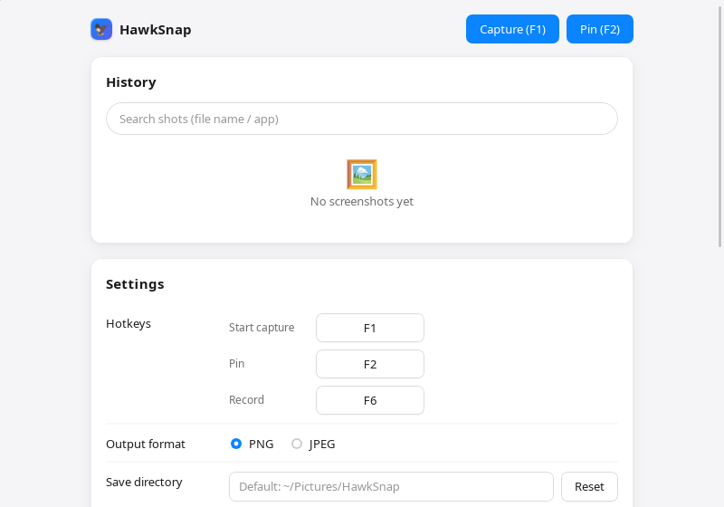
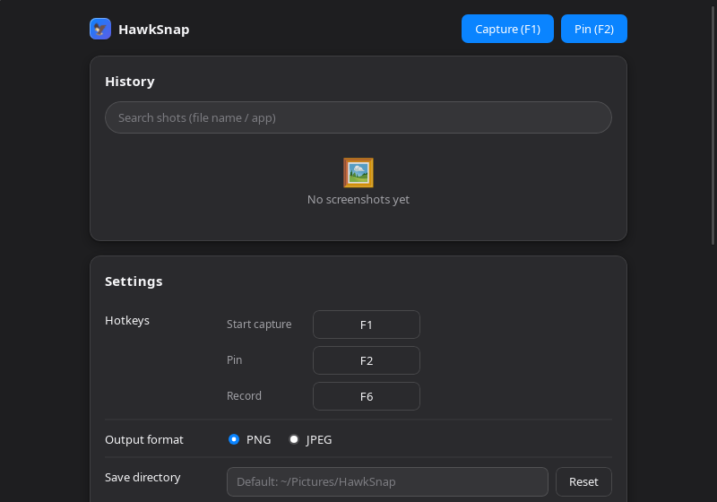

<div align="center">


# HawkSnap

### 像鹰一样准，一按就截

*Press, frame, done.* ／ *按下快捷键、框住、完事。*

**免费 · 纯本地 · 三平台（macOS / Windows / Linux）· MIT**

[](https://github.com/huluohu/HawkSnap/releases)
[](#下载)
[](https://github.com/huluohu/HawkSnap/actions/workflows/pipeline.yml)
[](LICENSE)

</div>

---

<p>
  
  
</p>

HawkSnap 是一款免费、纯本地的轻量级截屏 + 录屏工具——无账号、无云端、无遥测。

## 功能

- **截图**：全局热键呼出冻结帧覆盖层，拖拽框选（Enter / 双击确认，Esc 取消），确认后进剪贴板并保存到 `~/Pictures/HawkSnap`；
- **智能吸附**：悬停即高亮光标下的元素或窗口，单击直接选中（元素 → 窗口 → 整屏三级回退）；方向键 1px 微调（Shift 10px），贴近窗口边缘 8px 自动吸附；框选后动作浮条一键复制 / 保存 / 标注；
- **贴图**：F2 把图像钉在桌面——按住拖拽、滚轮缩放（10%–3200%）、Ctrl+滚轮调透明度、Esc 关闭，多贴图级联错开；
- **标注编辑器**：矩形 / 椭圆 / 箭头 / 画笔 / 荧光笔 / 马赛克 / 序号 / 文字 / 裁剪共 9 类工具，撤销重做无步数限制，⌘S 保存；
- **OCR 文字识别**：编辑器内整图识别，中英双语（PP-OCRv4，纯本地推理），结果逐行点击复制 / 导出 txt，文本进历史全文检索；
- **录屏**：F6 进入选区模式（拖拽 = 区域，Enter / 双击 = 整屏），悬浮条计时 + 暂停 / 恢复 / 停止；系统声音随录（AAC）；H.264 MP4 落 `~/Movies/HawkSnap`；可选 **GIF 导出**（无限循环，无音频）与**摄像头画中画**（仅 MP4）；
- **长截图**：托盘入口，拖选区域后滚动页面，模板匹配拼接成长图（画布上界 256MB / 40000px）；
- **按键显示**：录制中实时显示按下的组合键（如 ⌘⇧A），只读旁路不吞按键；
- **历史记录**：每次截图自动入库（本地 SQLite），缩略图网格 + 中英文全文搜索 + 重新编辑 / 贴图 / 打开目录；
- **延时截图**：托盘菜单可选 1 / 2 / 3 / 5 秒倒计时；
- **浏览器插件**：Chrome / Edge 插件一键截取整页或选区，直接发送到桌面端编辑（Native Messaging 桥）；
- **自动更新**：Ed25519 签名的更新通道，坏签名更新包拒绝安装；
- **双语界面**：中文 / English，随系统语言或手动切换。

## 下载

从 [Releases](https://github.com/huluohu/HawkSnap/releases) 下载对应平台的安装包：

| 平台 | 安装包 | 自动更新 |
| --- | --- | --- |
| macOS 12.3+（Apple Silicon / Intel） | dmg | ✅ |
| Windows 10 1903+ / 11（x64） | NSIS 安装器 / MSI | ✅ |
| Linux（x64） | AppImage / deb / rpm | ✅ |

应用内「设置 → 自动更新」可检查并安装新版本。

## 平台能力差异

| 能力 | macOS | Windows / Linux |
| --- | --- | --- |
| 截图（区域 / 全屏） | ✅ | ✅ 跨平台后端 |
| 窗口自动识别（悬停选窗） | ✅ | ❌（降级为手动画框） |
| 录屏 / 画中画 / 长截图 / 贴图 / 按键显示 | ✅ | ❌（入口明确报错，不静默缺失） |
| OCR / 历史 / 编辑器 / 浏览器插件 | ✅ | ✅ |

## 使用

| 快捷键 | 功能 | 说明 |
| --- | --- | --- |
| **fn+F1**（或 F1*） | 截图 | 注册的是标准 F1 键；macOS 默认 F1 是亮度键，按 fn+F1 触发截图，系统亮度调节不受影响 |
| **F2**（可自定义） | 贴图 | 钉最近截图或剪贴板图像 |
| **F6**（可自定义） | 录屏 | 进入选区模式；录制中再按停止 |

热键均可在主面板设置中自定义（冲突时保存失败并提示）。主面板常驻托盘，从托盘菜单打开。

## 权限说明（macOS）

- **屏幕录制**：首次截图时系统会请求；若未弹窗或截图失败，前往 系统设置 → 隐私与安全性 → 屏幕录制 开启 HawkSnap，然后重启应用。
- **辅助功能**：智能吸附悬停高亮与按键显示需要（系统设置 → 隐私与安全性 → 辅助功能）。未授权时拖拽框选照常可用，只是没有悬停高亮。
- **摄像头**：录制画中画需要；未授权时录制本身不受影响，只是成片不含相机画面。

## 已知限制

- Windows 安装器未代码签名（首次运行 SmartScreen 会告警）；macOS dmg 未做公证。
- GIF 导出无音频、不含画中画；GIF 抽帧队列有界（约 22 帧），长录制产出的 GIF 只覆盖收尾窗口（MP4 始终是全程）。
- 长截图只支持单轴纵向滚动；周期性内容（聊天气泡等）可能被拒绝拼接（宁可不拼，绝不产出重影图）。
- OCR 模型首次使用需联网下载约 60MB（此后离线可用）；OCR 不支持 Intel macOS。
- 录屏中退出应用会产生损坏的 MP4（退出不收尾录制器）。
- Rust 侧错误文案暂为中文（界面已双语）。

## 从源码构建

```bash
# macOS 12.3+ / Node.js 20+ / Rust stable
cd app
npm install
npm run tauri dev      # 开发
npm run tauri build    # 构建（产物在 workspace 根 target/release/bundle/）
```

Linux 构建需要 `libwebkit2gtk-4.1-dev libgtk-3-dev libayatana-appindicator3-dev librsvg2-dev` 等（见 `.github/workflows/pipeline.yml` 的 Linux 步骤）。

## 许可

[MIT](LICENSE)。第三方组件声明见 [LICENSE-THIRD-PARTY.md](LICENSE-THIRD-PARTY.md)。
